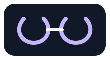

<p align="center"></p>
<p align="center"></p>
<p align="center"><a href="LICENSE"></a>   </p>
<p align="center"></p>

## 🧭 Overview
A small React and TypeScript playground for understanding effect setup, dependency changes, cleanup, and development StrictMode behavior.

## ✨ Features
- 🧪 Increment a dependency and inspect cleanup-before-next-setup ordering
- ⏱️ Toggle a timer-backed effect and see its cleanup stop the interval
- 🔍 Observe the extra development setup/cleanup cycle caused by StrictMode

## 🎬 Demo
Start the Vite development server and use the dependency and effect controls. No hosted demo is claimed.

## 🚀 Quick Start
```bash
npm install
npm run dev
```

## 🧰 Tech Stack
- 🧩 React, TypeScript, and Vite
- 🔒 Runs locally in the browser
- 📦 Standard npm development dependencies

## 🗂️ Folder Structure
```text
react-effect-cleanup-lab/
├── assets/mark.svg
├── src/{App.tsx,main.tsx,style.css}
├── index.html
├── vite.config.ts
├── tsconfig.json
├── package.json
├── .gitignore
├── LICENSE
└── README.md
```

## 🛣️ Roadmap
- [ ] Add a second effect with independent dependencies
- [ ] Add a timeline export

## 🤝 Contributing
Issues and pull requests are welcome. Keep the effect examples small and explain development-only behavior.

## 📄 License
Released under the [MIT License](LICENSE).

<p align="center"></p>